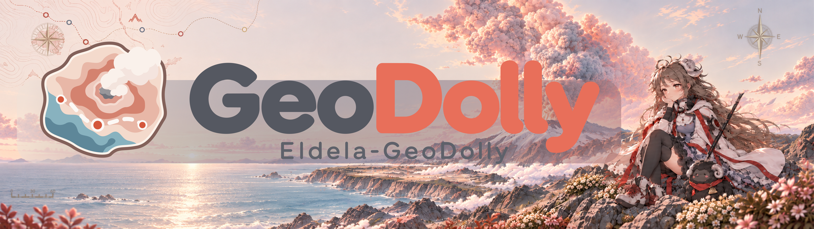

# GeoDolly

**English** · [简体中文](README.zh.md)

**GeoDolly** is an MCP toolkit for exploring places with OpenStreetMap data. This is the **rollback compatibility branch**, for Hosts without MCP Apps or complete App-tool registration support. It runs the AI map in the backend and exposes its viewport tools as ordinary MCP tools. For the main release, see [master](https://github.com/MoYuanMBS/Eldela-GeoDolly/blob/master/README.md).



## What differs in rollback

| Area | Behavior in this branch |
| --- | --- |
| AI map | Playwright Chromium runs on the server and keeps an independent AI view for each enabled map session. No App-tool registration is required. |
| User map | MCP Apps display the User map. Legacy UI can embed its HTML resource when supported; other clients can open `interactive_map_url` in a browser. |
| `visual_output` | `none` provides the User map without an AI session. `interactive` and `screenshot` are aliases: both create the backend AI map and attempt an initial image. |
| Images | Results contain `visual_url`, when available, rather than Base64 image blocks or App image messages. `web.yaml` uses `snapshot.max_image_bytes`, default 20 MiB of WebP binary, instead of master's `max_base64_bytes`. |

## Deploy this branch

Use **Node.js 24.22.1**, npm 11.19.1, and **Python 3.12**. With nvm, run `nvm install` and `nvm use` in the checkout. On Linux/macOS, start from a checkout of `rollback` and run in the repository root:

```bash
python3.12 -m venv .venv
.venv/bin/python -m pip install -r requirements.txt
npm ci
npx playwright install chromium
cp -n deploy/geomcp.env.example deploy/geomcp.env
```

Chromium is required at startup even if requests use `none`. Install it under the account that runs the backend; on Linux with missing system libraries, use `npx playwright install --with-deps chromium`. On Windows, use `py -3.12 -m venv .venv`, `.\.venv\Scripts\python.exe`, and copy the env example manually. Existing installations should also follow [runtime upgrades and CA certificates](https://github.com/MoYuanMBS/Eldela-GeoDolly/blob/master/user_doc/en/01-getting-started.md#runtime-upgrades-and-ca-certificates); keep `certifi>=2026.10.19` from `requirements.txt`.

Edit `deploy/geomcp.env`. Replace its two `GEOMCP_*_CONFIG_JSON` entries with this local example, keeping one definition per variable:

```dotenv
GEOMCP_WEB_CONFIG_JSON={"http":{"listen_host":"127.0.0.1","listen_protocol":"http","map":{"port":23336,"public_origin":"http://127.0.0.1:23336"}}}
GEOMCP_APP_CONFIG_JSON={"ui":{"iframe_max_width_px":1600,"iframe_max_height_px":1000}}
GEOMCP_LOG_LEVEL=INFO
```

**Only `app.yaml` and `web.yaml` support configuration environment overrides**, through `GEOMCP_APP_CONFIG_JSON` and `GEOMCP_WEB_CONFIG_JSON` respectively. Other YAML files must be edited directly. Values are JSON objects: objects merge by field, while arrays and scalars replace the YAML value. Base YAML files remain required; invalid overrides fail validation. Optionally set `PYTHON_PATH` to an absolute Python 3.12 executable; otherwise the project `.venv` is used. See [environment configuration](https://github.com/MoYuanMBS/Eldela-GeoDolly/blob/master/user_doc/en/02-configuration.md#environment-overrides) for details.

Choose the public address **before building**:

| Deployment | Configuration and instructions |
| --- | --- |
| Local HTTP | Use the example above if your Host permits local HTTP. A cloud Host cannot reach your computer's `localhost`. |
| Localhost over public HTTPS | Follow [Cloudflare named tunnel setup](https://github.com/MoYuanMBS/Eldela-GeoDolly/blob/master/user_doc/en/01-getting-started.md#localhost-through-cloudflare-tunnel), forwarding a stable domain to `http://127.0.0.1:23336`. Quick Tunnels do not support SSE. |
| Server with a domain | Set `public_origin` to your domain, e.g. `https://maps.example.com`, and follow [DNS, HTTPS reverse proxy, and systemd setup](https://github.com/MoYuanMBS/Eldela-GeoDolly/blob/master/user_doc/en/04-web-yaml.md#server-deployment-with-a-domain-and-https). |

Some Hosts require public HTTPS for MCP connections or Apps. **This branch's Node listener supports HTTP only**: keep `listen_protocol: "http"`; HTTPS terminates at the proxy/tunnel, and the legacy `http.tls` fields have no effect. Forward the entire site, including map, image, tile, font and asset routes, preserve the public Host header, and support MCP streaming/SSE. The backend has no built-in Bearer/OAuth authentication. Playwright renders through internal HTTP.

Build and run with the **same env file**:

```bash
npm run build
node --env-file=deploy/geomcp.env node_modules/vite/bin/vite.js build
node --env-file=deploy/geomcp.env node_modules/vite/bin/vite.js build --config vite.launcher.config.ts
node --env-file=deploy/geomcp.env dist/index.js
```

`npm start` and `npm run build:web` do not load this file automatically. After changing the public address, rebuild both browser outputs and restart; rebuild after browser/style changes too. For systemd, use the actual Node 24 absolute path, the repository as `WorkingDirectory`, and this env file; after editing a unit, run `sudo systemctl daemon-reload` and `sudo systemctl restart geomcp`. Keep the backend and any proxy/tunnel running independently of the Host.

## Connect and make a map

Add a **Streamable HTTP** server in your Host: `http://127.0.0.1:23336/mcp` locally, or `https://maps.example.com/mcp` publicly. If `public_origin` includes a prefix, such as `https://maps.example.com/geomcp`, the MCP endpoint is that exact URL, without another `/mcp`. For a direct deployment without an external authentication layer, select no authentication. Enable the connection and its tools in the current conversation if required, and allow enough time for analysis and queueing.

Confirm that the Host lists all **five backend tools**:

| Tool | Purpose / input |
| --- | --- |
| `location_search` | Find and confirm a place. |
| `tool_a` | Analyze roads, railways and the wider transport network. |
| `tool_b` | Analyze a bounded place and nearby facilities. |
| `geomcp_fit_ai_map_bbox` | Move the AI view with `{session_id, bbox: {south, west, north, east}}`. |
| `geomcp_set_ai_map_center_zoom` | Move the AI view with `{session_id, center: {longitude, latitude}, zoom}`; `zoom` is a nonnegative integer. |

First call `location_search`:

```json
{"queries":[{"query":"Central Park, New York, USA"}]}
```

Confirm a returned candidate, then call `tool_b` with the **search** session ID and that candidate's returned `index`. Indices start at 1; replace both example values below. If the search returns `no_match`, refine the query first.

```json
{"session_id":"REPLACE_WITH_SEARCH_SESSION_ID","selected_indices":[1],"basemap":"osm","visual_output":"screenshot"}
```

Read the returned analysis, open `interactive_map_url`, and inspect `visual_url` when present. Use the **final map `session_id` from this result** for subsequent AI viewport tools. Each viewport tool returns the actual view and attempts a new image; it changes only the AI view, without rerunning the geographic query. There are no separate App capture or User-to-AI alignment tools in this branch.

Check User-map embedding, both AI tools, and image URL retrieval separately. Legacy embedding depends on Host support, and receiving an image URL does not guarantee that the Host can fetch or display it. If embedding is unavailable, open the browser map. Reconnect and reopen the UI after deployment changes.

Map sessions default to 24 hours and do not renew on access. AI sessions consume server browser memory; the capacity is `tool_execution.max_workers × 10` (20 by default), and reaching it closes the session with the earliest expiry. Expiry, browser failure or cancellation/timeout can close the map and its images. Restarting the backend does not restore old sessions; generate a new map. Images are held only in memory: the initial image and latest tool image are retained, and the tool-image URL is reused. A failed image attempt reports a warning without a new URL.

## Shared documentation

The full guide stays on **master**; this branch uses this README instead of a separate `user_doc/`. Follow the rollback behavior above wherever the branches differ, especially AI tools, output modes, HTTPS termination and image budgets.

| Topic | Master reference |
| --- | --- |
| Configuration and optional map request fields | [Environment overrides](https://github.com/MoYuanMBS/Eldela-GeoDolly/blob/master/user_doc/en/02-configuration.md#environment-overrides) · [Map tool inputs](https://github.com/MoYuanMBS/Eldela-GeoDolly/blob/master/user_doc/en/01-getting-started.md#map-tool-inputs) |
| Basemaps and filters | [Tiles and filters](https://github.com/MoYuanMBS/Eldela-GeoDolly/blob/master/user_doc/en/05-tiles-and-filters.md) |
| Base rules and Experts | [Base and Experts](https://github.com/MoYuanMBS/Eldela-GeoDolly/blob/master/user_doc/en/06-base-and-experts.md) |
| Overlay styling | [User styles](https://github.com/MoYuanMBS/Eldela-GeoDolly/blob/master/user_doc/en/07-user-styles.md) |
| User-map inspection and measurement | [Inspect features and take measurements](https://github.com/MoYuanMBS/Eldela-GeoDolly/blob/master/user_doc/en/01-getting-started.md#inspect-features-and-take-measurements) |

GeoDolly relies on online place, feature, and basemap services, and results depend on OpenStreetMap coverage. It does not provide routing or live traffic.

## License and policies

GeoDolly is source-available under the [License](LICENSE), which permits specified noncommercial and research uses and reserves project artwork and branding rights. Commercial and operational military use are prohibited. Read the bilingual [Use and Data Policy](POLICY.md) before redistribution or deployment.
